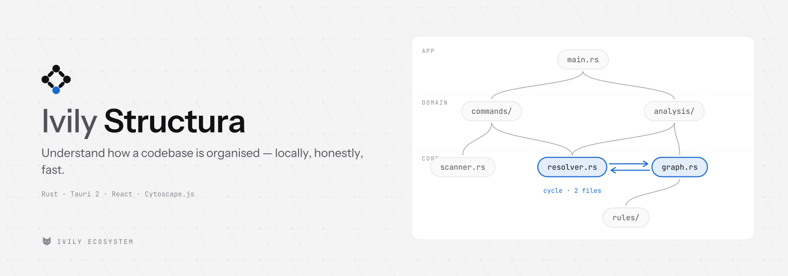
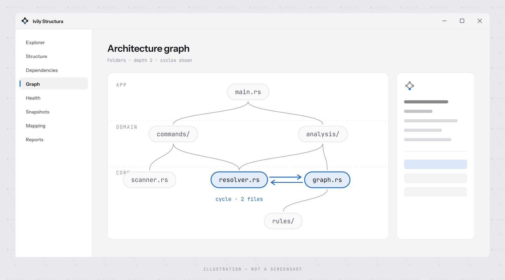
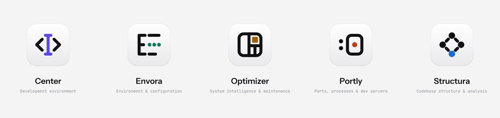

<p align="center">
  <picture>
    <source media="(prefers-color-scheme: dark)" srcset="assets/brand/banners/ivily-structura-readme-banner-dark.svg">
    
  </picture>
</p>

<p align="center">
  <a href="docs/USAGE.md">Usage</a> ·
  <a href="docs/ANALYSIS.md">What is measured</a> ·
  <a href="#development">Build</a> ·
  <a href="docs/ARCHITECTURE.md">Architecture</a> ·
  <a href="docs/DEVELOPMENT_PLAN.md">Status</a>
</p>

<p align="center">
  <a href="https://github.com/efecrtgl/ivily-structura/actions/workflows/ci.yml"></a>
  <a href="LICENSE"></a>
</p>

**Ivily Structura** is an open-source, lightweight desktop application (Windows-first) that analyses, visualises and documents software project structure: directory layout, languages and ecosystems, file roles, internal and external dependencies, circular dependencies and architecture health. It helps you get into unfamiliar repositories and keep an understandable overview of your own.

> [!NOTE]
> **Status — 0.1.0, not yet published.** All development phases are done; the installer and signed updater artifacts have been built locally. The first CI release needs the signing secrets ([docs/RELEASING.md](docs/RELEASING.md)), so **no GitHub release exists yet** — build from source for now.

<p align="center">
  <picture>
    <source media="(prefers-color-scheme: dark)" srcset="assets/brand/illustrations/ivily-structura-product-visual-dark.svg">
    
  </picture>
  <br><sub><i>Illustration, not a screenshot.</i></sub>
</p>

## Principles

| **Read-only** | **Local-first** | **Honest** |
|---|---|---|
| Projects are never modified. | No telemetry, no uploads. Secrets-bearing files (`.env`, keys, credentials) are never read. | Exact vs. estimated values are labelled; every finding states its confidence. **No opaque score.** |

## Features

**Understand the layout**

- **Project explorer** — lazy tree for large repos; `.gitignore`-aware; hidden, ignored, excluded, symlinked and sensitive entries flagged; search, filter and sort by size, lines, complexity and coupling.
- **Structure analysis** — entry points, source/test/doc roots, file roles, manifests, generated files, architectural pattern hints with evidence.
- **60+ languages recognised**; imports, exports and symbols for 30 (JS/TS/JSX/TSX, Vue, Svelte, HTML, CSS/SCSS/Less, Rust, C/C++, C#, Go, Java, Kotlin, Swift, Python, PHP, Ruby, Lua, Zig, Shell, PowerShell, SQL, GraphQL, Terraform, Docker) — each with a declared support level.
- **Ecosystems & frameworks** — npm/pnpm/yarn/bun, Cargo, Go modules, Python (pip/Poetry/uv/Pipenv), Composer, Bundler, Maven/Gradle, .NET, SwiftPM, Pub, CMake, Docker, Terraform; React, Vue, Svelte, Next, Tauri, Axum, Django, FastAPI, Laravel, Spring Boot, ASP.NET and more.

**Follow the relationships**

- **Dependency graph** — import resolution with a recorded method (relative, tsconfig paths, aliases, workspaces, module paths, namespaces…), external packages (declared/undeclared/unused), cycle detection with concrete paths, fan-in/fan-out.
- **Interactive architecture graph** — files or folders, focus + depth, filters, layouts, cycles, external packages, PNG/JSON export; bounded so large graphs stay readable.

**Judge the health — with evidence**

- **Architecture health** — 25 configurable rules (cycles, bottlenecks, coupling, layer violations, unused modules, large/complex files, nesting, duplicates, missing docs/tests, conflicting lockfiles, risky dependency specs, sensitive files…) with severity, confidence, evidence and suggestions.
- **Snapshots & comparison** — over time or between projects.
- **Project mapping** — layers, module groups, annotations, relations and notes that survive re-analysis, with a visual layer map.

**Share and keep**

- **Reports** — Markdown, JSON, CSV; configurable sections.
- **Analysis profiles**, persistent history, backup/restore, signed auto-updates.
- **Ivily Ecosystem Protocol** — optional, read-only integration with Ivily Center.

## How analysis works

```
scan ─► lang ─► providers ─► project ─► deps ─► graph ─► health
 │        │         │            │         │        │        └ 25 rules · severity · confidence · evidence
 │        │         │            │         │        └ iterative Tarjan SCC · shortest concrete cycle
 │        │         │            │         └ import resolution, method recorded per edge
 │        │         │            └ roles · ecosystems · frameworks · pattern hints
 │        │         └ lexical imports / exports / symbols / complexity
 │        └ 60+ languages, declared support level
 └ ripgrep's ignore engine · limits · symlinks never followed
```

A Rust core does all filesystem access and analysis as plain Rust modules (no Tauri inside the domain); the React UI has **no** filesystem, shell or HTTP plugin and talks only through validated commands. Support levels and their reliability are documented in [docs/ANALYSIS.md](docs/ANALYSIS.md); module layout in [docs/ARCHITECTURE.md](docs/ARCHITECTURE.md).

**Tech stack:** Rust · Tauri 2 · React 19 (plain JavaScript) · SQLite · Cytoscape.js · rayon

## Development

**Requirements:** Windows 10/11 · [Rust](https://rustup.rs) (stable, MSVC toolchain) · Node.js 22+ · Visual Studio Build Tools (C++) · WebView2 runtime.

```powershell
npm ci
npm run tauri dev        # run the app (dev server on port 1450)
npm test                 # UI tests
cd src-tauri; cargo test # Rust tests
cargo run --release --example analyze -- C:\path\to\project   # CLI analysis summary
```

**Install (after the first release):** a per-user installer (no administrator rights) and a portable zip will be published on [Releases](https://github.com/efecrtgl/ivily-structura/releases). See [docs/INSTALLATION.md](docs/INSTALLATION.md).

## Documentation

| | |
|---|---|
| [Installation](docs/INSTALLATION.md) | Installer, portable build, building from source |
| [Usage](docs/USAGE.md) | Walkthrough of every view |
| [Analysis](docs/ANALYSIS.md) | What is measured, how reliably, and how rules work |
| [Architecture](docs/ARCHITECTURE.md) | Module layout and extension points |
| [IEP](docs/IEP.md) | Ivily Ecosystem Protocol |
| [Releasing](docs/RELEASING.md) | Versioning strategy and release process |
| [Development plan](docs/DEVELOPMENT_PLAN.md) | Audit and phases |
| [Security](SECURITY.md) · [Contributing](CONTRIBUTING.md) · [Changelog](CHANGELOG.md) | |

## Security

Structura only reads. Paths are validated and resolved inside the selected project root, symlinks are never followed, and secrets-bearing files are never opened. Nothing leaves your machine. Report vulnerabilities privately as described in [SECURITY.md](SECURITY.md).

## The Ivily ecosystem

<p align="center">
  <picture>
    <source media="(prefers-color-scheme: dark)" srcset="assets/brand/ecosystem/ivily-ecosystem-lineup-dark.svg">
    
  </picture>
</p>

Structura answers `--iep describe` / `--iep request` without opening a window, so [Ivily Center](https://github.com/efecrtgl/ivily-center-main) can read its identity and health through the local, read-only **Ivily Ecosystem Protocol** ([docs/IEP.md](docs/IEP.md)). Sibling products: [Envora](https://github.com/efecrtgl/ivily-envora) · [Optimizer](https://github.com/efecrtgl/ivily-optimizer) · [Portly](https://github.com/efecrtgl/ivily-portly).

Brand assets — logos, icons, banners and usage rules — are in [`assets/brand/`](assets/brand/README.md).

## Licence

[MIT](LICENSE) © 2026 efecrtgl
